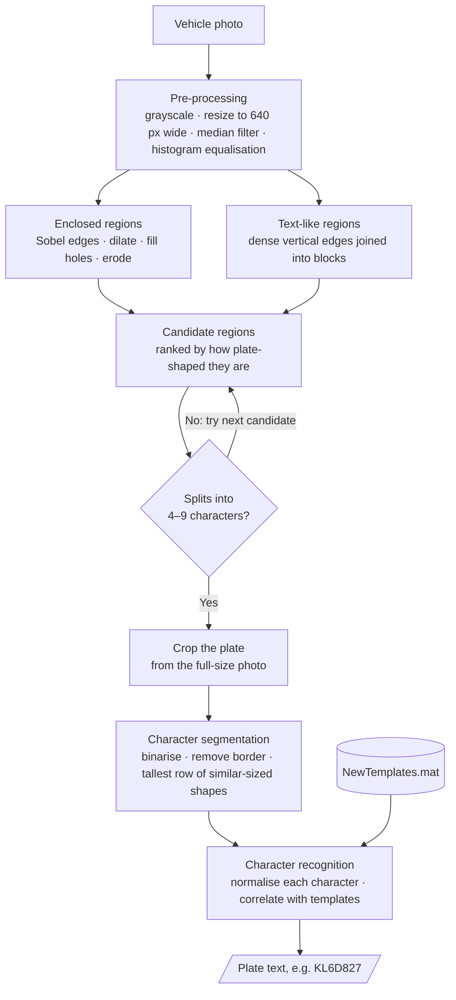
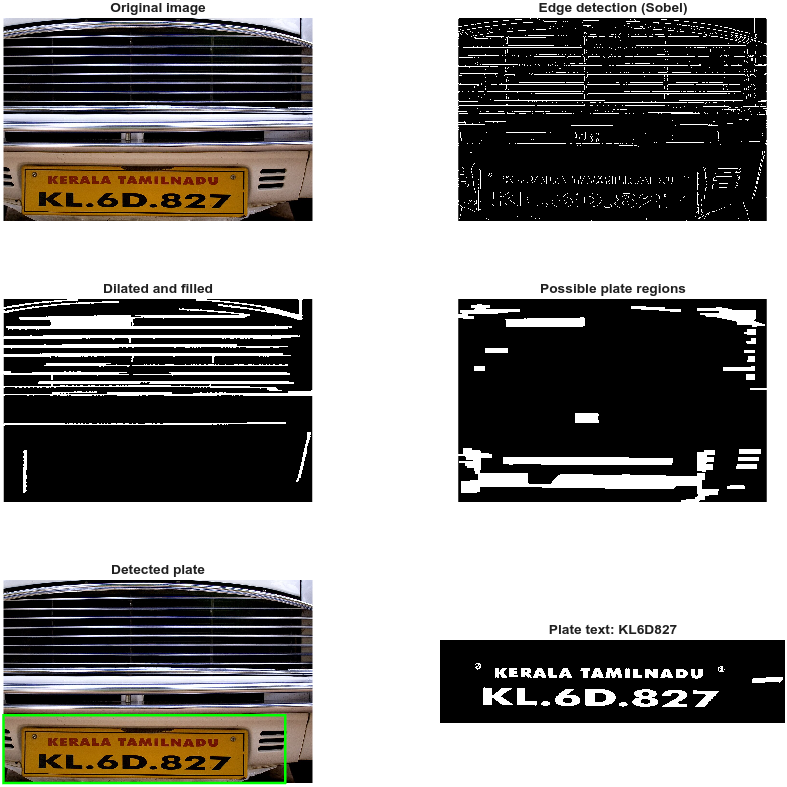

# VEHICLE-PLATE-RECOGNITION-SYSTEM-USING-MATLAB

A vehicle plate recognition (VPR) system in MATLAB. It finds the number plate in a photo of a vehicle, splits the plate into characters and reads each character by template matching.

## Flow diagram



## Result



Plate read: **`KL6D827`** (the plate shows `KL.6D.827`; the dots are not characters).

Photo: ["Southern grill"](https://www.flickr.com/photos/58435577@N00/354981944/) by Lian Chang, [CC BY 2.0](https://creativecommons.org/licenses/by/2.0/), via [Wikimedia Commons](https://commons.wikimedia.org/wiki/File:License_plate_of_Kerala,_India.jpg). The result image above shows this photo with the processing steps added.

## Requirements

- MATLAB with the **Image Processing Toolbox**

## Usage

```matlab
PBL_No_Plate                       % runs on the example photo
```

To use your own photo:

```matlab
imageFile = 'car.jpg';
PBL_No_Plate
```

The script shows each processing step in a figure and prints the result:

```
Number plate: KL6D827
```

## How it works

| Step | File | What it does |
|---|---|---|
| 1. Pre-processing | `detectPlate.m` | Grayscale, resize to 640 px wide, median filter (noise), histogram equalisation (contrast) |
| 2. Plate extraction | `detectPlate.m` | Candidates come from two sources: regions enclosed by edges (Sobel → dilate → fill holes → erode), and blocks of dense vertical edges, which characters produce but grilles and body lines do not. Candidates are ranked by how plate-like their shape is (width:height about 2–6). The top 15 are checked in order, and the first that splits into 4–9 characters is cropped from the full-size photo |
| 3. Character segmentation | `segmentCharacters.m` | Binarise the plate, remove the frame, then find the tallest row of similar-sized shapes with at least 4 members. Smaller text such as a state name is ignored. Both dark-on-light and light-on-dark text are tried |
| 4. Character recognition | `readLetter.m`, `normalizeCharacter.m` | Crop each character, pad narrow ones (like `I` and `1`), resize to the template size and pick the template with the highest 2-D correlation (`corr2`) |
| 5. Result | `PBL_No_Plate.m` | Runs steps 1–4, shows the intermediate images and prints the plate text |

## Templates

The repo includes `NewTemplates.mat`, built from the images in `templates/` (characters `A`–`Z` and `0`–`9` rendered in DejaVu Sans Bold).

Plate fonts vary, so for best results build templates from characters cut out of real plates in your region. Put one image per character in a folder, named after the character it shows (add a suffix for extra variants of one character):

```
my_templates/
  A.png  A_2.png  B.png  ...  Z.png  0.png  ...  9.png
```

Then run:

```matlab
createTemplates('my_templates')
```

This saves `NewTemplates` (the images, 42×24 pixels) and `TemplateLabels` (which character each one is). Older `NewTemplates.mat` files without `TemplateLabels` still work and are read in the original 48-template order.

## Tests

```matlab
cd tests
run_tests
```

`run_tests` builds its own car images and templates, so it needs no data files. It checks each step and the full pipeline.

## Limitations

- Works best on clear, front-facing photos where the plate is large and roughly horizontal. Small or distant plates are usually not read.
- Reads one row of characters, so two-row plates are not supported.
- Template matching only recognises the fonts present in your templates.
- Database comparison of the recognised plate is not included.
